<div align="center">



<br><br>

<a href="https://github.com/iammirrr/Unity-Ads-Manager-Plugin/stargazers"></a>


### Show Unity Ads in your game with one prefab and one line of code.

Banner, interstitial and rewarded ads, already wired together.<br>
Drop the prefab into your first scene, paste your Game IDs, call a method. Free.

<a href="#quick-start"><kbd>&nbsp;Quick start&nbsp;</kbd></a>&nbsp;
<a href="#setup-guide"><kbd>&nbsp;Setup guide&nbsp;</kbd></a>&nbsp;
<a href="#api"><kbd>&nbsp;API&nbsp;</kbd></a>&nbsp;
<a href="#demo-game"><kbd>&nbsp;Demo game&nbsp;</kbd></a>&nbsp;
<a href="#troubleshooting"><kbd>&nbsp;Troubleshooting&nbsp;</kbd></a>

<br>

<a href="https://github.com/iammirrr/Unity-Ads-Manager-Plugin"></a>

<sub>If this saves you an afternoon, hit <b>⭐ Star</b> at the top of the page. It helps other Unity devs find the plugin.</sub>

</div>

<br>

## Quick start

1. **Install Unity Ads.** *Window › Package Manager › Unity Registry*, search **Advertisement**, install **Advertisement Legacy**.
2. **Import the plugin.** Download [**Unity Ads Manager Plugin.unitypackage**](https://github.com/iammirrr/Unity-Ads-Manager-Plugin/raw/main/Assets/Unity%20Ads%20Manager%20Plugin.unitypackage) and double-click it.
3. **Drop in the prefab.** Drag `Assets/Ads Plugin/AdsManager.prefab` into your first scene and paste your Game IDs on it.
4. **Show an ad** from any script:

```csharp
AdsManager.Instance.rewardedAds.ShowRewardedAd();
```

That's the whole thing. The [setup guide](#setup-guide) below walks through each step with screenshots of what goes where.

<br>

## How it works



`AdsManager` is a singleton that stays alive between scenes. When your game starts it initializes Unity Ads and loads one banner, one interstitial and one rewarded ad, so they're ready when you ask for them. Each ad format is its own short script you can read in a minute:

| File | What it does |
| --- | --- |
| `AdsManager.cs` | The singleton. Gives you `AdsManager.Instance` from any script, in any scene. |
| `InitializeAds.cs` | Starts Unity Ads with your Android or iOS Game ID. Holds the test mode switch. |
| `BannerAds.cs` | Loads, shows and hides a banner at the bottom center of the screen. |
| `InterstitialAds.cs` | Shows a full-screen ad, then loads the next one. |
| `RewardedAds.cs` | Shows a rewarded ad, then loads the next one. Your reward code goes in `OnUnityAdsShowComplete`. |
| `AdsManager.prefab` | All five scripts on one GameObject, already wired together. |

<br>

## Setup guide

### Before you start

- **Unity 2021.3 LTS or newer.** The demo project uses 2021.3.23f1.
- **A Unity Ads project** with a Game ID for Android, iOS or both. You'll find them in the Monetization section of the [Unity Cloud dashboard](https://cloud.unity.com).
- **Build target set to Android or iOS.** *File › Build Settings*, pick the platform, *Switch Platform*. Ads don't run on the PC/Mac/Linux target.

> [!NOTE]
> Since version 4.4.1, Unity calls this SDK package **Advertisement Legacy** and recommends LevelPlay mediation for new projects. Unity still serves ads to direct integrations like this one, but says apps using it [may see reduced ad performance from April 1, 2026](https://docs.unity.com/en-us/ads-unity/4.19.0/sdk-integration/banner-ads.md).

### 1. Install the Unity Ads package

Open *Window › Package Manager*, switch the dropdown to **Unity Registry**, search for **Advertisement** and install **Advertisement Legacy**.

Prefer editing files? Add this line inside `dependencies` in `Packages/manifest.json` instead:

```json
"com.unity.ads": "4.4.2",
```

If you skip this step, Unity shows `The type or namespace name 'Advertisements' does not exist` as soon as you import the plugin.

### 2. Import the plugin

Download [**Unity Ads Manager Plugin.unitypackage**](https://github.com/iammirrr/Unity-Ads-Manager-Plugin/raw/main/Assets/Unity%20Ads%20Manager%20Plugin.unitypackage), then double-click it or use *Assets › Import Package › Custom Package…*. Keep everything ticked and click **Import**. You'll get a new `Assets/Ads Plugin/` folder.

Want the demo game too? Clone this repo instead and open it with Unity Hub (*Add › Add project from disk*).

### 3. Add the prefab to your first scene

Drag `Assets/Ads Plugin/AdsManager.prefab` into the **first scene your game loads**, like your main menu or boot scene.

You only need it once. It survives scene changes on its own, and if a scene loads a second copy, that copy deletes itself.

### 4. Paste your IDs

Select **AdsManager** in the Hierarchy and fill in the Inspector:



| Component | Field | What to put there |
| --- | --- | --- |
| Initialize Ads | Android Game Id, Ios Game Id | Your Game IDs from the Unity dashboard. |
| Initialize Ads | Is Testing | **On** while you develop. **Off** for the build you publish. |
| Banner, Interstitial, Rewarded Ads | Android / Ios Ad Unit Id | Already set to Unity's defaults (`Banner_Android`, `Rewarded_iOS` and so on). Change them only if your ad units have different IDs. |

> [!IMPORTANT]
> The prefab ships with the demo game's Game IDs. Replace them with your own, or your impressions are credited to the demo project instead of yours.

Press **Play**. The Console should show `Ads Initialized...`, `Banner Ad Loaded` and `Interstitial Ad Loaded`.

### 5. Show ads from your code

Call these from any script, in any scene:

```csharp
// Banner: show it during gameplay, hide it on menus
AdsManager.Instance.bannerAds.ShowBannerAd();
AdsManager.Instance.bannerAds.HideBannerAd();

// Interstitial: between levels or after a game over
AdsManager.Instance.interstitialAds.ShowInterstitialAd();

// Rewarded: when the player taps "Watch an ad for 2x coins"
AdsManager.Instance.rewardedAds.ShowRewardedAd();
```

Interstitial and rewarded load the next ad right after showing one, so you can call them again later without loading anything yourself.

### 6. Give the reward

Open `Assets/Ads Plugin/RewardedAds.cs` and find `OnUnityAdsShowComplete`. Code inside the `if` runs only when the player watched the whole ad:

```csharp
public void OnUnityAdsShowComplete(string placementId, UnityAdsShowCompletionState showCompletionState)
{
    if (placementId == adUnitId && showCompletionState.Equals(UnityAdsShowCompletionState.COMPLETED))
    {
        Debug.Log("Ads Fully Watched .....");
        // Give the reward here: coins, an extra life, a score multiplier...
    }
}
```

If the player skips or closes the ad early, nothing inside the `if` runs, so they don't get the reward.

### 7. Before you publish

- [ ] Your own Game IDs are in **Initialize Ads**, not the demo's
- [ ] **Is Testing** is off
- [ ] The ad unit IDs match the ones in your Unity dashboard
- [ ] `app-ads.txt` is set up on your developer website. Unity warns that banner demand can drop a lot without it

<br>

## API

Everything goes through `AdsManager.Instance`:

| Call | What happens |
| --- | --- |
| `bannerAds.ShowBannerAd()` | Shows the banner at the bottom center of the screen. |
| `bannerAds.HideBannerAd()` | Hides the banner. |
| `bannerAds.LoadBannerAd()` | Loads a banner. `AdsManager` already does this at startup. |
| `interstitialAds.ShowInterstitialAd()` | Shows a full-screen ad, then loads the next one. |
| `interstitialAds.LoadInterstitialAd()` | Loads an interstitial. Done for you at startup. |
| `rewardedAds.ShowRewardedAd()` | Shows a rewarded ad, then loads the next one. |
| `rewardedAds.LoadRewardedAd()` | Loads a rewarded ad. Done for you at startup. |

To move the banner to the top, change `BannerPosition.BOTTOM_CENTER` in `BannerAds.cs` to `BannerPosition.TOP_CENTER` (or any other `BannerPosition`).

<br>

## Demo game

This repo is a complete Unity project with a tiny clicker game. Tap **+** and **−** to change the score. Reach 10 or drop below 0 and you land on the end screen, where you can replay.

The ad calls are already written but commented out, so you can switch them on one at a time and see what each one does. Uncomment the commented-out lines in `GameManager.cs`, `EndButtons.cs` and `RewardedAds.cs` and you get:

- a **banner** during gameplay, shown a second after the game starts and hidden on the end screen
- an **interstitial** after every third game
- a **rewarded** "Multiplier" button on the end screen that makes every tap worth 2 points next round

To run it, open `Assets/Scenes/Gameplay.unity`, switch the build target to Android or iOS, and press **Play**.

<br>

## Troubleshooting

<details>
<summary><b>"The type or namespace name 'Advertisements' does not exist"</b></summary>
<br>

The Unity Ads package isn't installed. Do [step 1](#1-install-the-unity-ads-package), then let Unity recompile.

</details>

<details>
<summary><b>Nothing happens in the Editor</b></summary>
<br>

Check that your build target is Android or iOS (*File › Build Settings*). Unity Ads doesn't run on the PC/Mac/Linux target. In the Editor you'll see Unity's placeholder ads, not real ones.

</details>

<details>
<summary><b>The banner never shows up</b></summary>
<br>

If you call `ShowBannerAd()` the moment the game starts, the banner may not have loaded yet. Show it a moment later. The demo waits one second:

```csharp
IEnumerator Start()
{
    yield return new WaitForSeconds(1f);
    AdsManager.Instance.bannerAds.ShowBannerAd();
}
```

</details>

<details>
<summary><b>My published game only shows test ads</b></summary>
<br>

**Is Testing** is still on in **Initialize Ads**. Turn it off, then build again.

</details>

<details>
<summary><b>No ads show up in my published game</b></summary>
<br>

Check that the Game IDs on the prefab are yours, not the demo's, that the ad unit IDs match your dashboard, and that `app-ads.txt` is set up for your developer website.

</details>

<details>
<summary><b>NullReferenceException on AdsManager.Instance</b></summary>
<br>

The scene you pressed Play in doesn't contain the prefab, and no earlier scene loaded it. Start from the scene that has **AdsManager**, or add the prefab to the scene you're testing.

</details>

<br>

<div align="center">

<a href="https://github.com/iammirrr/Unity-Ads-Manager-Plugin"></a>

### Got ads running in your game? Star the repo.

Stars are how I know people use this, and they push the repo up in GitHub search<br>so other Unity devs can find it. It takes one click at the top of this page.

Found a bug or want another ad format? [Open an issue](https://github.com/iammirrr/Unity-Ads-Manager-Plugin/issues).

<br>

<sub>Made by <a href="https://github.com/iammirrr">Mir</a>. Unity and Unity Ads are trademarks of Unity Technologies. This plugin isn't made or endorsed by Unity.<br>The artwork is built from the demo game's own sprites, background and Luckiest Guy font (by Astigmatic, Apache 2.0).</sub>

</div>
